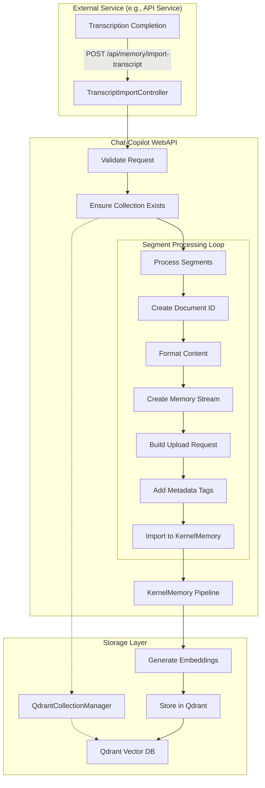

# Transcript Import Feature Documentation

## Overview

The Transcript Import feature enables the chat-copilot service to receive and process video transcript segments from external services (such as the YouTube transcription service), converting them into searchable vector embeddings stored in Qdrant. This allows users to query video content through natural language chat interactions.

## Architecture Overview



## Key Components

### 1. TranscriptImportController

**Location**: `/webapi/Controllers/TranscriptImportController.cs`

**Purpose**: REST API endpoint that receives transcript data and orchestrates the import process.

**Key Methods**:
- `ImportTranscriptAsync()` - Main entry point for transcript imports
- Validates input data
- Manages collection creation
- Processes each transcript segment
- Returns import results

### 2. Request/Response Models

#### ImportTranscriptRequest
```csharp
public class ImportTranscriptRequest
{
    public required string UserId { get; set; }
    public required string ChannelId { get; set; }
    public required string VideoId { get; set; }
    public required string VideoTitle { get; set; }
    public required string VideoUrl { get; set; }
    public required List<TranscriptSegment> Segments { get; set; }
}

public class TranscriptSegment
{
    public required string Text { get; set; }
    public double StartTime { get; set; }
    public double EndTime { get; set; }
}
```

#### ImportTranscriptResponse
```csharp
public class ImportTranscriptResponse
{
    public string Status { get; set; }
    public string CollectionName { get; set; }
    public int SegmentsImported { get; set; }
    public int TotalSegments { get; set; }
    public string? Error { get; set; }
}
```

### 3. Integration with KernelMemory

The feature leverages Microsoft's KernelMemory framework for document processing:

1. **Document Creation**: Each transcript segment is converted into a document with formatted content
2. **Stream Processing**: Text is converted to a memory stream for compatibility with KernelMemory's file-based API
3. **Pipeline Steps**: Documents go through standard pipeline steps:
   - `extract` - Extract text content
   - `partition` - Partition into chunks
   - `gen_embeddings` - Generate vector embeddings
   - `save_records` - Save to vector store

### 4. QdrantCollectionManager Integration

**Purpose**: Manages user-specific vector collections in Qdrant

**Key Operations**:
- `EnsureCollectionExistsAsync()` - Creates collection if it doesn't exist
- `GetCollectionNameString()` - Generates consistent collection names
- Collection naming pattern: `cc-{userId}-{channelId}-{contextId}`

## Data Flow

### 1. Request Reception
```
External Service → POST /api/memory/import-transcript → TranscriptImportController
```

### 2. Validation Phase
- Verify required fields are present
- Sanitize video ID and channel ID
- Check user authorization

### 3. Collection Management
```csharp
// Ensure user-specific collection exists
string contextId = "default";
await _qdrantCollectionManager.EnsureCollectionExistsAsync(
    request.UserId, 
    request.ChannelId, 
    contextId
);

// Get collection name
string collectionName = _qdrantCollectionManager.GetCollectionNameString(
    request.UserId, 
    request.ChannelId, 
    contextId
);
```

### 4. Segment Processing
For each transcript segment:

```csharp
// Create unique document ID
string documentId = $"video_{request.VideoId}_{segmentIndex:000}";

// Format content with metadata
string formattedContent = $"""
    Video: {request.VideoTitle}
    URL: {request.VideoUrl}
    Time: {segment.StartTime:F1}s - {segment.EndTime:F1}s
    
    {segment.Text}
    """;

// Convert to stream
using var stream = new MemoryStream();
using var writer = new StreamWriter(stream);
await writer.WriteAsync(formattedContent);
await writer.FlushAsync();
stream.Position = 0;

// Create upload request
var uploadRequest = new DocumentUploadRequest
{
    DocumentId = documentId,
    Index = collectionName,
    Files = new List<DocumentUploadRequest.UploadedFile> 
    { 
        new($"transcript_{request.VideoId}_{segmentIndex:000}.txt", stream) 
    },
    Steps = pipelineSteps
};
```

### 5. Metadata Tagging
Each document is tagged with metadata for later retrieval:

```csharp
uploadRequest.Tags.Add("user_id", request.UserId);
uploadRequest.Tags.Add("channel_id", request.ChannelId);
uploadRequest.Tags.Add("video_id", request.VideoId);
uploadRequest.Tags.Add("video_title", request.VideoTitle);
uploadRequest.Tags.Add("video_url", request.VideoUrl);
uploadRequest.Tags.Add("start_time", segment.StartTime.ToString("F1"));
uploadRequest.Tags.Add("end_time", segment.EndTime.ToString("F1"));
uploadRequest.Tags.Add("content_type", "video_transcript");
uploadRequest.Tags.Add("import_id", importId);
```

### 6. Vector Generation and Storage
- KernelMemory processes the document through its pipeline
- Text embeddings are generated using configured model (e.g., text-embedding-ada-002)
- Vectors are stored in Qdrant with associated metadata

## Error Handling

### Segment-Level Error Handling
- Errors in individual segments don't fail the entire import
- Failed segments are logged but processing continues
- Final response indicates partial success

### Request-Level Error Handling
- Missing required fields return 400 Bad Request
- Collection creation failures return appropriate error
- Unexpected errors are logged and return 500 Internal Server Error

## Security Considerations

1. **Authentication**: Endpoint requires valid authentication token
2. **Authorization**: Users can only import to their own collections
3. **Input Validation**: Video IDs and channel IDs are sanitized
4. **Resource Limits**: Consider implementing limits on:
   - Number of segments per request
   - Total text size per import
   - Rate limiting for imports

## Usage Example

### Request
```http
POST /api/memory/import-transcript
Authorization: Bearer {token}
Content-Type: application/json

{
  "userId": "a388b2f1-fcde-41d2-b7f7-489f4fbd0582",
  "channelId": "b77adc23-29d0-4db9-ac23-fa97fe8f0fce",
  "videoId": "dQw4w9WgXcQ",
  "videoTitle": "Example Video Title",
  "videoUrl": "https://www.youtube.com/watch?v=dQw4w9WgXcQ",
  "segments": [
    {
      "text": "This is the first segment of the transcript",
      "startTime": 0.0,
      "endTime": 30.5
    },
    {
      "text": "This is the second segment of the transcript",
      "startTime": 30.5,
      "endTime": 60.0
    }
  ]
}
```

### Response (Success)
```json
{
  "status": "success",
  "collectionName": "cc-a388b2f1-fcde-41d2-b7f7-489f4fbd0582-b77adc23-29d0-4db9-ac23-fa97fe8f0fce-default",
  "segmentsImported": 2,
  "totalSegments": 2
}
```

### Response (Partial Success)
```json
{
  "status": "partial",
  "collectionName": "cc-a388b2f1-fcde-41d2-b7f7-489f4fbd0582-b77adc23-29d0-4db9-ac23-fa97fe8f0fce-default",
  "segmentsImported": 1,
  "totalSegments": 2,
  "error": "Some segments failed to import. Check logs for details."
}
```

## Integration with Chat Features

Once transcripts are imported, they become searchable through the chat interface:

1. **Semantic Search**: User queries are converted to embeddings and matched against transcript vectors
2. **Context Retrieval**: Relevant segments are retrieved based on similarity scores
3. **Source Attribution**: Responses include video title, URL, and timestamp references
4. **Multi-Video Support**: Queries can span multiple videos in the same collection

## Performance Considerations

### Batching
- Large transcripts are processed segment by segment
- Each segment creates a separate vector entry
- Consider batching multiple segments into single documents for very long videos

### Async Processing
- Import operations are async throughout
- Multiple segments can be processed concurrently (with appropriate limits)

### Memory Usage
- Each segment creates a temporary memory stream
- Streams are properly disposed after use
- Consider implementing streaming for very large transcripts

## Monitoring and Logging

### Key Log Points
1. Import request received with video ID and segment count
2. Collection creation/verification
3. Each segment import (success/failure)
4. Final import summary

### Metrics to Track
- Import request count by user
- Average segments per import
- Import success/failure rates
- Average processing time per segment
- Vector storage usage by collection

## Future Enhancements

1. **Batch Import API**: Support importing multiple videos in a single request
2. **Progress Callbacks**: WebSocket or SSE for real-time import progress
3. **Duplicate Detection**: Check for existing segments before importing
4. **Custom Embeddings**: Support different embedding models per collection
5. **Segment Merging**: Intelligently merge short segments for better context
6. **Import History**: Track and query import history per user/channel

## Troubleshooting

### Common Issues

1. **404 Not Found**: Ensure the endpoint path is correct and deployment is updated
2. **Empty Segments**: Check that transcript segments contain text
3. **Collection Creation Fails**: Verify Qdrant is accessible and has sufficient resources
4. **Slow Imports**: Check embedding service performance and network latency
5. **Missing Vectors**: Verify KernelMemory pipeline is configured correctly

### Debug Steps

1. Check controller logs for request reception
2. Verify collection exists in Qdrant UI
3. Query Qdrant directly to confirm vectors are stored
4. Test retrieval through chat interface
5. Monitor KernelMemory pipeline logs for processing errors